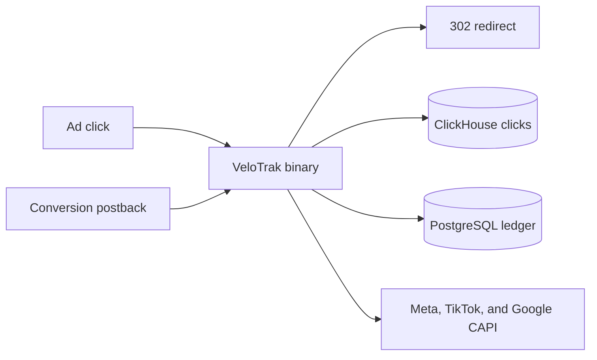

[](https://github.com/VeloTrak/Velotrak/releases/latest)
[](https://velotrak.app/)

# VeloTrak — a self-hosted ad tracker that keeps clicks and conversions on your server

Clicks and conversions live on your own server, and you can export them in full at any time. When a lander or a route needs changing, you tell your AI assistant — it shows a diff first and applies the change only after you confirm.

## What is VeloTrak

VeloTrak is a self-hosted ad tracker for media buyers, affiliate marketers, and agencies. One Linux binary on your server stores every click in ClickHouse and the conversion ledger in PostgreSQL. The software fee is flat — it is not billed per click — and Meta, TikTok, and Google conversions API (CAPI) postbacks are included on every plan, including Free. Ninety MCP tools let an AI assistant create landers, edit code, pull reports, and adjust routing; edits and deletes are shown as a diff and run only after you confirm.

VeloTrak the ad tracker (https://velotrak.app/) is not the Timex Velo-Trak cycling watch.

This repository publishes release binaries and documentation. The application source is not in this repo. Pricing, the live demo, and the license checkout are on the website.

## Key features

All of the following are shipped. The same console is available in the [read-only demo](https://demo.velotrak.app/admin/#email=demo%40velotrak.app&password=admin123) (the demo account is already filled in; click Sign in).

- **Campaign performance.** Spend, revenue, and ROAS per campaign. Deletes go to Trash. Pending revenue is counted separately.
- **Reports.** Drill down, pick columns, keep views in the URL, and search globally. The dashboard auto-refreshes every 30 seconds.
- **Flow routing.** 25 condition fields — geo, device, time, and more — with a summary per path.
- **Landers.** Upload a ZIP, or edit code in the browser with a live preview.
- **Costs.** Costs are allocated every 30 minutes, so ROAS is after real costs. Pro adds automatic cost sync and alerts that can pause a losing campaign.
- **CAPI on every plan.** Meta (Purchase, Lead, and other events), TikTok Events API, and Google via the GA4 Measurement Protocol. One account per platform on Free; unlimited CAPI accounts on Pro. Binding priority is campaign, then traffic source, then broadcast.
- **MCP.** 90 tools an AI assistant or a script can call. Free is read-only. Pro is read/write. Destructive actions need a diff, then confirmation. Permissions are chosen per area.
- **Backup and restore.** Full-table backups. Restore runs in a single transaction and checks row counts.
- **Your brand.** Your logo and name, a Chinese and English interface, telemetry off by default.
- **Built-in templates.** 30+ traffic-source templates and 25+ affiliate-network templates.
- **Offline grace.** If licensing breaks, tracking keeps running, with a 30-day offline grace period.

A load test published by VeloTrak measured **3,071 clicks per second** on a shared 4-vCPU VM, with the app, PostgreSQL, ClickHouse, and the load generator on the same machine. In that run, 92,135 clicks were sent and none were lost — about 265 million clicks a day at that rate. The floor server size (2 vCPU / 4 GB) is sized for at least 800 clicks per second, about 69 million a day. Figures on the marketing dashboard are samples, not a customer's books.

## Who it is for

- **Media buyers** who want spend, revenue, and ROAS on their own server, with CAPI back to Meta, TikTok, and Google.
- **Affiliate marketers** who route clicks across landers and offers and need the full click log to stay exportable.
- **Agencies and in-house teams** who need more than one person. The Team plan adds operator and viewer roles, an audit log, API keys, one MCP token per teammate or agent, and 3 installs per seat.

Free is there to prove the chain on real traffic: 3 active campaigns, unmetered clicks, no credit card.

## How it works

VeloTrak is a single statically linked Go binary. It serves the redirect path, the admin panel, and the API in one process. PostgreSQL holds configuration and the conversion ledger. ClickHouse holds the clicks. The official installer runs those databases in Docker, bound to `127.0.0.1`, and runs VeloTrak itself as a systemd service — not as a container — so a signed self-update can replace the binary in place.



A click is answered with a 302 redirect and its attribution parameters are kept. The click is stored in ClickHouse. A later conversion is written to the PostgreSQL ledger and can be posted back to the ad platform. You can see the CAPI result in the postback log.

Setup on a fresh Linux server is the install command, then five steps in the wizard: bring the stack up, set timezone and currency, connect a traffic source, create a campaign and flow, and bind CAPI. The wizard does not require hand-editing a config file.

Details, checksums, and the exact v1.0.0 files are in [docs/installation.md](docs/installation.md).

## Quick start

v1.0.0 ships Linux binaries only: `velotrak-linux-amd64` and `velotrak-linux-arm64`, plus `checksums.txt` and `manifest.json`. Both binaries are statically linked. They do not include PostgreSQL or ClickHouse. The release's install command downloads the matching binary from [GitHub Releases](https://github.com/VeloTrak/Velotrak/releases/latest), checks its SHA-256, installs Docker if it is missing, and starts the databases for you.

Requirements: Linux with systemd, x86_64 or arm64, root, and curl. Minimum 2 vCPU / 4 GB RAM. Recommended 4 vCPU / 8 GB. A VPS from about $10/month is enough for the floor tier. You rent the server yourself; VeloTrak does not sell hosting.

```bash
# On a Linux server (x86_64 or arm64), as root.
curl -fsSL https://velotrak.app/install.sh | sudo bash
```

Pin this release:

```bash
curl -fsSL https://velotrak.app/install.sh | sudo VELOTRAK_VERSION=v1.0.0 bash
```

When it finishes, open `http://<this-server>:8080/admin/` and create the admin account. Allow TCP port 8080 in the firewall or cloud security group if the page does not load.

Check the binary you downloaded yourself:

```bash
sha256sum -c checksums.txt --ignore-missing
./velotrak-linux-amd64 version
# velotrak 1.0.0 linux/amd64 license-root=production
```

Re-run the same install command to upgrade. Configuration and data are kept. The previous binary is left at `/opt/velotrak/velotrak.old`. A licensed install can also update from the admin panel.

To look first, without installing: open the [live demo](https://demo.velotrak.app/admin/#email=demo%40velotrak.app&password=admin123).

## Data ownership and export

Your clicks, conversions, campaigns, and ledger stay in databases on your machine. VeloTrak's privacy policy states that this business data is not sent to VeloTrak, that VeloTrak cannot access it, and that it is not sold. Product telemetry is off by default.

A paid license check sends only what validation needs: an install identifier, the software version, the plan, and the license status. A licensing failure does not stop tracking. There is a 30-day offline grace period.

You can export in full at any time. Backups cover the tables; a restore is one transaction and checks row counts. If you cancel, the subscription stays usable until the end of the period you already paid, and the data remains on your server for you to take with you. Terms allow a full refund within 14 days of purchase.

## Pricing

USD. Annual billing is 12 months for the price of 10. Cancel anytime; the plan runs until the period ends. Confirmed on https://velotrak.app/ and https://velotrak.app/llms.txt on 13 Nov 2026.

| Plan | Price | What you get |
| --- | --- | --- |
| Free | $0 | 3 active campaigns, 1 user, 1 install. Clicks are not metered. Reports cover the last 15 days and 2 dimensions; older data is kept. CAPI on all 3 platforms, 1 account each. Import up to 20 campaigns at a time. MCP read-only. Email alerts. |
| Pro | $49/month, or $41/month billed annually ($490/year) | Unlimited campaigns, full report history, 5 dimensions. Unlimited CAPI accounts and imports, custom metrics. Automatic cost sync, alerts that auto-pause losing campaigns. MCP read/write (90 tools), scheduled email reports. Telegram and webhook alerts, LP Protect, your branding. Up to 3 admin users. 1 install per seat. Email support. |
| Team | $99/month, or $83/month billed annually ($990/year) | Everything in Pro, plus unlimited users with operator or viewer roles, an audit log, API keys, one MCP token per teammate or agent, 3 installs per seat, and priority support. |
| Founder | $399 once | All Pro features for life, 1 install, 12 months of updates included. Presale, 100 seats. |

The license fee does not grow with click volume. The server is a separate bill you pay a hosting provider. Checkout is at https://velotrak.app/license/ and the pricing section is https://velotrak.app/#pricing.

## Compared with other ad trackers

People shopping this category usually look at Voluum, RedTrack, Binom, BeMob, Keitaro, and FunnelFlux. The useful differences are where the click log lives, whether the fee grows with events, and what an AI assistant is allowed to change.

Checked against each vendor's own public pages on 13 Nov 2026. Event definitions are not the same product to product, and Voluum and RedTrack both had a promotion on the page that day. Full notes and source links: [docs/comparison.md](docs/comparison.md).

| Product | Where it runs | How the fee works | Where the click data lives |
| --- | --- | --- | --- |
| VeloTrak | Your Linux server | Flat license. Clicks are not metered. Pro is $49/month or $490/year. | Your PostgreSQL and ClickHouse |
| Voluum | Voluum's cloud | Plans include an event quota, then an overage. Their docs define events as visits, clicks, and conversions; the pricing page also counts impressions, with 10 impressions as 1 event. | Voluum's cloud |
| RedTrack | RedTrack's cloud | Plans include an event quota (clicks, conversions, and postbacks), then an overage. | RedTrack's cloud |
| BeMob | BeMob's cloud | Plans include an event quota (impression, visit, click, or conversion), then an overage on paid plans. | BeMob's cloud |
| FunnelFlux Pro | FunnelFlux's cloud | $99/month includes 2 million events, then $10 per extra million. | FunnelFlux's cloud |
| Keitaro | Software you install; the license is separate from the server | Edition license. The yearly toggle lists Starter €40/month, Advanced €72/month, Expert €104/month. | The server you operate |
| Binom | Self-hosted, or Binom Cloud | Flat self-hosted license. The price page shows $149 and $104 for v2 and says click volume is not what you pay for. Binom Cloud is listed at $299. | Your server, or Binom's cloud if you buy that plan |

## FAQ

**What is VeloTrak, and is it the Timex watch?**
VeloTrak is a self-hosted ad tracker at https://velotrak.app/. It is not the Timex Velo-Trak bike computer.

**What server do I need?**
Linux, x86_64 or arm64, systemd. Minimum 2 vCPU / 4 GB (sized for at least 800 clicks per second). Recommended 4 vCPU / 8 GB. One command installs VeloTrak with PostgreSQL and ClickHouse. More detail is in [docs/installation.md](docs/installation.md).

**If the server loses internet, or the license check fails, does tracking stop?**
No. Licensing is separate from the click path, with a 30-day offline grace period.

**Does any of my campaign data reach VeloTrak?**
No. Clicks and conversions stay in your databases. Telemetry is off by default. A license check sends only the install id, version, plan, and license status.

**What does Free include?**
Unmetered clicks, up to 3 active campaigns, reports on the last 15 days (2 dimensions), CAPI on Meta, TikTok, and Google with one account each, imports of up to 20 campaigns at a time, and read-only MCP. No credit card.

**Can an AI assistant wreck a lander through MCP?**
Edits and deletes take two steps: a diff first, then your confirmation. Permissions are set per area. Free MCP is read-only.

**How should I read 3,071 clicks per second?**
That figure is from a load test on one shared 4-vCPU VM. The app, PostgreSQL, ClickHouse, and the load generator all ran on that box. 92,135 clicks were sent and none were lost.

**Can I try it before paying?**
Yes. Use the [read-only demo](https://demo.velotrak.app/admin/#email=demo%40velotrak.app&password=admin123), or install Free and send it real traffic. Neither asks for a card.

More answers: [docs/faq.md](docs/faq.md).

## Documentation

- [Install from the v1.0.0 release](docs/installation.md)
- [FAQ](docs/faq.md)
- [Comparison notes](docs/comparison.md)
- [llms.txt](llms.txt) — short product summary for AI search tools
- [Changelog](CHANGELOG.md)
- [Support](SUPPORT.md)
- [Security](SECURITY.md)

## Links

- Website: https://velotrak.app/
- Website (中文): https://velotrak.app/zh/
- Pricing: https://velotrak.app/#pricing
- Buy or manage a license: https://velotrak.app/license/
- Live demo: https://demo.velotrak.app/admin/#email=demo%40velotrak.app&password=admin123
- Product summary for AI tools: https://velotrak.app/llms.txt
- Privacy: https://velotrak.app/privacy/
- Terms: https://velotrak.app/terms/
- Releases: https://github.com/VeloTrak/Velotrak/releases
- Support: [support@velotrak.app](mailto:support@velotrak.app)

Use of the software is covered by the [Terms of Service](https://velotrak.app/terms/). This repository does not include an open-source license file.
